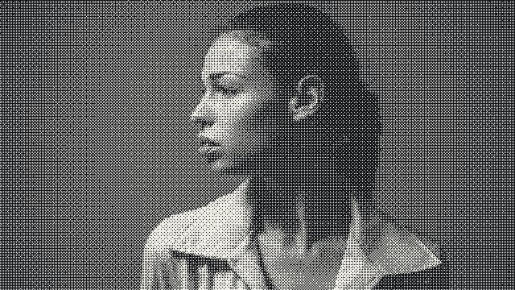
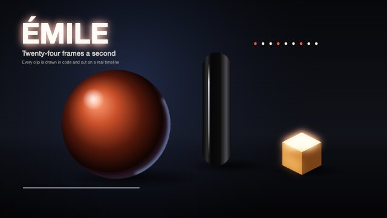

<h1 align="center">Émile packs</h1>

<p align="center">
  <b>The free, open parts films are made of — shaders, sounds, instruments — each with a guide an AI reads before it uses one.</b><br>
  For <a href="https://emilefilm.com">Émile</a>, the video editor built for AI — and for any coding agent that makes video.
</p>

<p align="center">
  
  
  
  
  
  
</p>

<p align="center">
  <a href="#shaders">Shaders</a> ·
  <a href="#sounds">Sounds</a> ·
  <a href="#instruments">Instruments</a> ·
  <a href="#reference-skills">Reference Skills</a> ·
  <a href="#use-them">Use them</a> ·
  <a href="#reading-a-skillmd">Reading a SKILL.md</a> ·
  <a href="#for-pack-authors">For pack authors</a>
</p>

## What's here

One kind of part per section; more kinds will come, each a section of its own.

| Kind | What | For your own agent | In Émile |
|---|---|---|---|
| [Shaders](#shaders) | 15 filters and 4 transitions, GLSL with a WebGL2 runner | [`skills/emile-shaders`](skills/emile-shaders/SKILL.md) | a filter clip over the tracks under it, a transition between two clips |
| [Sounds](#sounds) | 112 sound effects, 8 for each kind of moment, CC0 WAV, each marked with the moment it goes on | [`skills/emile-sounds`](skills/emile-sounds/SKILL.md) | an effect clip at the moment it is heard |
| [Instruments](#instruments) | 9 sampled instruments (SFZ over CC0 samples) | — (they need an SFZ player; the samples are a release asset) | the film's music, written as a score and played on them |
| [Reference Skills](#reference-skills) | Guides an AI reads before it chooses: scoring, sound across a cut, choosing filters, motion, subtitle styles | `skills/<name>` | read by Émile's AI with the task they belong to |

Everything is listed in a signed `index.json`; Émile downloads a part the first time a film uses it and checks every file against the index.

## Shaders


### What it does

Tell Émile's AI how a moment should feel, and it lays the right filter over it: it picks the pack by what each one brings, reads that pack's guide, and sets it the way the guide says. You never need a filter's name or a parameter.

| Say | What happens |
|---|---|
| "Add a touch of grain." | `emile/grain` over the whole film at amount 0.15–0.25: a light grain is a finish, the one kind of filter that may run the whole length. |
| "Make the flashback feel like an old tape." | `emile/vhs` over that scene only, two to six seconds, then back to the clean present. |
| "Some tape feel, please." | No span named, so the AI asks where, recommending the opening seconds, and says why: tape over a whole product demo blurs its interface. |
| "Turn the whole film navy and cream." | `emile/duotone` with those two colours as hex, over the whole film because it was asked for. |

#### Seconds, not minutes

Most filters are an accent: a few seconds on the moment that calls for them — a headline held as a print, a hit on the beat, a memory on tape — between clean shots. Held for a whole film they tire the eye, and over an interface, numbers or body text they hide what the picture is there to say:


Every guide says how long its filter holds up, and Émile's AI keeps to it unless you ask for more. The exceptions are finishes light enough to read as a surface: a little grain, paper under an illustrated film, a faint lens fringe.

#### By kind of film

A filter that lifts a music video can ruin a product demo. [`skills/choosing-filters`](skills/choosing-filters/SKILL.md) sorts all fifteen across 29 kinds of film, from product launches, software demos and customer stories to vlogs, music videos, AI short dramas and sports highlights: which may run long, which only for a moment, which to avoid. Each kind was checked by drawing two photographs of it under every filter. In Émile it is an official reference Skill you can bring into a chat; any agent can read it.

### The filters

Each has `amount` (0 leaves the picture exactly as it is, 1 is the whole effect) and two to four parameters of its own. Shown at their defaults.

#### Print — ink on paper

<table>
<tr>
<td width="33%"><br><b>Halftone</b> · <code>emile/halftone</code><br>A picture pulled through a printer's screen: ink dots on paper, bold enough to read as print.</td>
<td width="33%"><br><b>Risograph</b> · <code>emile/risograph</code><br>A two-colour print run: two inks laid one over the other, a little out of register.</td>
<td width="33%"><br><b>CMYK</b> · <code>emile/cmyk</code><br>Four-colour process seen up close: dots that never quite line up.</td>
</tr>
</table>

#### Texture — a surface, not an effect

<table>
<tr>
<td width="33%"><br><b>Grain</b> · <code>emile/grain</code><br>A picture you can almost touch: fine grain that lives from frame to frame.</td>
<td width="33%"><br><b>Dither</b> · <code>emile/dither</code><br>A one-bit picture: two colours, and a pattern of pixels doing the work of every grey.</td>
<td width="33%"><br><b>Paper</b> · <code>emile/paper</code><br>Printed on real paper: the tooth of the sheet under the picture, whites warmed to its tone.</td>
</tr>
</table>

#### Distort — glass, not glitch

<table>
<tr>
<td width="50%"><br><b>Fluted glass</b> · <code>emile/fluted-glass</code><br>Seen through reeded glass: shapes kept, detail hidden.</td>
<td width="50%"><br><b>Displace</b> · <code>emile/displace</code><br>Bands of the picture slip sideways: something has shifted, and holds there.</td>
</tr>
</table>

#### Color — fewer inks, more intent

<table>
<tr>
<td width="50%"><br><b>Duotone</b> · <code>emile/duotone</code><br>The whole picture in two inks: one for the darks, one for the lights.</td>
<td width="50%"><br><b>Palette</b> · <code>emile/palette</code><br>A handful of chosen inks, like a screen print, a blueprint or a thermal camera.</td>
</tr>
</table>

#### Glow — light from the picture itself

<table>
<tr>
<td width="50%"><br><b>Bloom</b> · <code>emile/bloom</code><br>Light spills from the brightest points into the dark, with the warm edge film gives it.</td>
<td width="50%"><br><b>Edge glow</b> · <code>emile/edge-glow</code><br>The outlines of a clear shape light up, like a rim of light behind it. For silhouettes, not faces.</td>
</tr>
</table>

#### Film — the medium the picture passes through

<table>
<tr>
<td width="33%"><br><b>CRT</b> · <code>emile/crt</code><br>A picture on a glass tube: scan lines, phosphor stripes, a gently curved face.</td>
<td width="33%"><br><b>VHS</b> · <code>emile/vhs</code><br>A tape played many times: soft, colours bleeding sideways, the bottom edge tearing.</td>
<td width="33%"><br><b>Chromatic aberration</b> · <code>emile/chromatic-aberration</code><br>A lens that splits light at its edges; the centre stays sharp.</td>
</tr>
</table>

### Transitions

| Pack | What it brings |
|---|---|
| `emile/dissolve` | The two pictures melt into each other, gently at both ends. |
| `emile/push` | The next picture slides in and pushes this one away: onward. |
| `emile/wipe` | A clean, designed change, like turning a page sideways. |
| `emile/zoom` | Flying in: going deeper, into the next idea. |

## Sounds

A hundred and twelve short sound effects to lay where something happens on screen, eight for each kind of moment, all CC0 (free for any use, no credit needed). Each is `emile/<tag>-<nn>/sound.wav`, 48 kHz 16-bit stereo, its peak at −1 dBFS, with a `pack.json` saying how long it is, how it sounds, where it comes from, and its **cut**: the second in the file that goes on the picture's moment (a hit's attack, a whoosh's peak, a riser's end). To lay one on a moment `T`, start it at `T − cut`.

| Tag | For |
|---|---|
| `click` | a tap, a button pressed |
| `pop` | something appearing: a card, a badge |
| `whoosh` | a move across the frame, a transition |
| `rise` | building into a reveal |
| `drop` | something landing or going away |
| `impact` | a hit on a cut, a title landing |
| `notify` | a message, a success, an error |
| `ambience` | a bed under a scene |
| `riser` | building for 1–4 s into a turn, loudest at its end |
| `swell` | a reversed reverb drawn into a turn |
| `impact` (`boom-*`) | a cinematic hit on the turn or the end, with its tail |
| `sub-drop` | a low fall under a hit |
| `sweep` | a pass-by, left to right, whose peak is the moment |
| `ambience` (`bed-*`) | a room, a building, a city at night, wind, rain, water: for footage without sound |

The first eight kinds were chosen by ear from Kenney's CC0 audio packs (Interface Sounds, UI Audio, Digital Audio, Sci-fi Sounds) and rubberduck's CC0 breaking, falling and hit sounds; [`scripts/sounds.json`](scripts/sounds.json) lists the choice and [`scripts/sounds.mjs`](scripts/sounds.mjs) makes the packs from the original files. The transition sounds and the beds (`riser`, `swell`, `boom`, `sub-drop`, `sweep`, `bed`) are synthesised by [`scripts/transitions.mjs`](scripts/transitions.mjs), layered as a sound designer would (a Shepard tone, a reversed cymbal, a falling low thump in a hall, a pass-by moving left to right), the same every time, so each one's cut is exact, and levelled by loudness so at gain 1 they sit right under music at −16 LUFS. In Émile the AI picks one by its tag and description and lays it as an effect clip; [`skills/emile-sounds`](skills/emile-sounds/SKILL.md) gives the same sounds to any agent, with the rules for using them and how to mix one into a video with ffmpeg.

## Instruments

A film's music in Émile is made one of two ways, both on the Mac: written as a score and played on these instruments (calm, cinematic, warm: the chords change and the hits land on the cuts), or generated from a style prompt with Google's [Magenta RealTime 2](https://github.com/magenta/magenta-realtime) for what the instruments can't play (electronic, pop, funk, hip-hop, rock). [`skills/scoring`](skills/scoring/SKILL.md) says which suits a film, how to write a score that follows the cuts, and how to write a prompt: the genres that come out full and the two that come out empty (techno, deep house), each tried with two seeds and heard. Every instrument is an SFZ over CC0 samples, made by [`scripts/instruments.mjs`](scripts/instruments.mjs) from libraries at pinned commits; its samples are published as a release asset ([`assets`](https://github.com/EmileFilm/emile-packs/releases/tag/assets)), not in the repository, and each has a phrase played on it (`preview.m4a`).

| Instrument | | From |
|---|---|---|
| `emile/piano` | A Kawai grand, close and warm | VCSL |
| `emile/strings`, `emile/strings-spiccato` | A string section: long notes, and short bounced ones | VSCO 2 CE |
| `emile/contrabass-pizz` | A double bass, plucked | VSCO 2 CE |
| `emile/harp`, `emile/vibraphone`, `emile/glockenspiel` | Plucked and struck: arpeggios, figures, sparkle | VCSL |
| `emile/drums` | An acoustic kit: kick, snare, hi-hats, crash | Virtuosity Drums |
| `emile/cinematic-perc` | A bass drum, a timpani, cymbal swells: weight on a cut | VCSL |

Any SFZ player plays them (Émile uses [sfizz](https://github.com/sfztools/sfizz)): unpack an instrument's samples asset into its folder, beside its `instrument.sfz`.

## Reference Skills

Guides Émile's AI reads before it chooses, written for an AI and readable by any agent: [`sound-transitions`](skills/sound-transitions/SKILL.md) (a film's sound following its picture's feeling, as editors do it: look at the cut film first, find its sections and moments, then a checklist of the few moves the picture asks for) with one Skill for each move: [`sound-muffle-release`](skills/sound-muffle-release/SKILL.md) (muffled before the jump, opened on it), [`sound-ambience-carry`](skills/sound-ambience-carry/SKILL.md) (a place's sound carried across a cut), [`sound-music-sections`](skills/sound-music-sections/SKILL.md) (a music for each section, handed over with a riser and a hit), [`sound-strong-ending`](skills/sound-strong-ending/SKILL.md), [`sound-match-cut`](skills/sound-match-cut/SKILL.md); [`scoring`](skills/scoring/SKILL.md) (a film's music: score or generate, tempo from the cuts, voicing, and which genres to prompt for), [`choosing-filters`](skills/choosing-filters/SKILL.md) (which filter for which moment and kind of film), [`motion`](skills/motion/SKILL.md) (how things move in a clip), and the subtitle styles (`skills/subtitle-<style>/`, each with an example page).

## Use them

### In Émile

Nothing to install. Say what you want in the chat, or type `#` and a filter's name; the first time a film uses a pack Émile downloads it from here, checks every file against the signed index, and keeps it for offline use. A filter is a clip on the timeline: it changes every track under it for as long as it lasts. Ask for music and the AI either writes a score for the film and plays it on the instruments, or generates a track in the style you name (its model, about 1 GB, is downloaded once you agree); a sound is an effect clip at the moment it is heard.

### With your own agent

`skills/emile-shaders/` is a Skill: copy that one folder into your agent's skills folder and it carries everything it needs: every filter's and transition's `shader.glsl`, `pack.json` and `SKILL.md`, a one-file WebGL2 runner, an example page and the references. For Claude Code that is `.claude/skills/` in your project (or `~/.claude/skills/` for every project):

```bash
git clone --depth 1 https://github.com/EmileFilm/emile-packs.git
cp -R emile-packs/skills/emile-shaders .claude/skills/
```

Then ask for the look ("put a halftone on the video in this page"): the agent finds the Skill, reads the filter's guide and wires the shader into your page. For any other agent, put the folder wherever it reads Skills from.

The sounds the same way: `cp -R emile-packs/skills/emile-sounds .claude/skills/`, then ask for them ("add a click when the button is pressed at 3.2 s"). The agent picks one by its tag and how it sounds, and mixes it in with ffmpeg as the Skill shows.

Without installing: hand your agent this repository's link, or clone it next to your project and point the agent at `skills/emile-shaders/SKILL.md` or `skills/emile-sounds/SKILL.md`.

### In your own code

`skills/emile-shaders/emile-shaders.js` runs any of the shaders with plain WebGL2, unchanged: a filter over an image, a `<video>` or a canvas, a transition between two pictures. `references/wiring.md` shows each in a few lines and what to keep when you wire them into another renderer; `references/contract.md` is the shader contract and the exact GLSL wrap Émile uses. Open `skills/emile-shaders/example.html` (straight from the folder, no server) to see every effect with its parameters as sliders.

## Reading a SKILL.md

A filter here is not just a shader. Each pack's `SKILL.md` is a short guide written for an AI to read, not a person to skim — the judgement of someone who has looked at the filter on real pictures. Its sections:

| Section | What it holds |
|---|---|
| first line | The feeling it brings, in a sentence. |
| Role | Its role when filters are stacked: colour, structure, optics, medium or finish. |
| When to use | The moments in a story that call for it, each with the settings that work, and the words people use when they want it. |
| Suits / Doesn't suit | The pictures it holds up on and the ones it fails on — product shots, interfaces, portraits by day and in low light — with the setting that mends a failure where one exists. |
| The tired version | The tired version of the effect, named outright, so nobody falls back into it. |
| How long | How long it holds up: seconds for most, the whole film only for a light finish. |
| Parameters | Each parameter with the values that actually work, not just its range. |

For example, from `emile/displace`:

> **How long** — An accent: 0.3–1.5 seconds, on the beat or the moment something goes wrong. Past two seconds it means nothing.

An agent that reads this before it places a filter picks the right one, sets it well, keeps it short, and tells you when your picture is one it fails on.

## For pack authors

An instrument or a sound is not written by hand: `scripts/instruments.mjs` and `scripts/sounds.mjs` make them from CC0 sources pinned in the scripts, and the build publishes an instrument's samples as its asset. What follows is for a shader pack.

<details>
<summary><b>A pack</b>: the folder, <code>pack.json</code> and the shader contract</summary>

A folder `<publisher>/<name>/`:

- `pack.json`: `id` (`emile/grain`), `kind` (`filter`, `transition` or `look`), `version` (semver; a published version never changes), `title` and `description` (`en`, `zh-CN`; the description says the feeling, not the technique), `category` (filters: `print`, `texture`, `distort`, `color`, `glow`, `film`), `params` (`[{ id, type: float | int | bool | color | vec2 | choice, default, min, max, step, options, label }]`), `animated`, `backends` (`{ "glsl": "shader.glsl" }`), `passes` (a filter drawn in more than one pass, below), `licence`, `publisher`.
- `shader.glsl`: GLSL ES 3.00 without a header. Colours in and out are premultiplied; `uv` runs 0–1 from the bottom left.
  - a filter defines `vec4 filterColor(vec2 uv)` and reads the picture under it with `getColor(uv)`;
  - a transition defines `vec4 transition(vec2 uv)` and reads `getFromColor(uv)`, `getToColor(uv)` and `progress` (0–1), the [gl-transitions](https://github.com/gl-transitions/gl-transitions) shape;
  - both get `vec2 resolution`, `float ratio`, `float frame`, `float fps`, `float seed`, and one uniform `p_<id>` per parameter (`color` is a `vec3`, `choice` the chosen option's index as an `int`). There is no clock: what moves reads `frame` and `seed`.
  - a shader declares no uniforms, inputs or outputs of its own, samples no texture directly, defines no `main()` and uses no extension. It can read the picture as often as it likes, never its own result.
  - a filter that needs a wide reach (a glow, a blur) may draw in passes: `passes` in `pack.json` lists them (`[{ id, glsl, scale }]`), each pass's shader defines `vec4 passColor(vec2 uv)` and is drawn into a picture of its own at `scale` × the frame, and the passes after it and the last shader read it with `getPass_<id>(uv)` (`skills/emile-shaders/references/contract.md`, Passes; `emile/bloom` and `emile/edge-glow` are drawn so).
  - sizes are in pixels of a frame 1080 pixels on its short side (or a share of that side), so 720p and 4K look alike, upright and square frames too.
- `SKILL.md`: the sections [above](#reading-a-skillmd).
- `preview.mp4` and `preview.jpg` beside them: not part of the pack (Previews, below).

</details>

<details>
<summary><b>The bar</b>: what a filter clears before it is published</summary>

Few good ones over many. A filter is published when it clears this, not when it compiles.

**Measured** by `scripts/review.mjs`, which draws each filter with Émile's own compositor over a product on a backdrop by day and by night, a product's screen, shapes on nothing, and the photographs given to it (portraits above all: a face is where a filter fails first):

```bash
node scripts/review.mjs --out <a folder outside this repository> --photo <portrait.jpg> --photo <another.jpg>
node scripts/review.mjs --out <folder> --photo <dark-portrait.jpg> --set halftone.exposure=0.7 halftone   # try what a SKILL.md recommends
node scripts/review.mjs --out <folder> --photo <portrait.jpg> --quick --no-measure --tiles docs/filters --tile-base bloom=night --tile-base edge-glow=graphic   # the cards above
```

- ✗ keeps a filter out: `amount` 0 changes a byte of the frame; one frame drawn twice differs; a filter that isn't `animated` changes between frames, or an animated one makes the whole frame's brightness wander; 720p and 4K don't look alike; a 1080p frame costs more than 4 ms.
- △ is answered in its SKILL.md: on some kind of picture, at its defaults, less than 0.7 of the run from dark to light is left, or the picture is hard to find in it (rank correlation under 0.6). The kind of picture goes under Doesn't suit, or the setting that mends it is given and tried with `--set`.

**Judged** from the sheets it writes (each picture as it is, at the defaults and at `amount` 0.5; pieces of the 1080p frame pixel for pixel; upright and square frames; one gallery per picture with every filter side by side, like the two above). Each answer must be yes:

1. **At a glance.** In the gallery, is the filter itself, and is the subject still the subject?
2. **Not the tired version.** Name the most worn-out version of this effect. Do the defaults avoid every mark of it?
3. **A process, not a decoration.** Does it follow how a real thing works (ink on paper, glass, tape, a tube, a lens), so you could say what in the world it is?
4. **Few colours.** Is the frame carried by the picture's own colours, or by at most five chosen ones, none neon by default?
5. **Half is still a look.** At `amount` 0.5, is it a lighter version of the same thing, not a dirty mix of two pictures?
6. **A reason in a film.** Can you name three moments of a story that call for it, how long it holds up, and the pictures it fails on?

</details>

<details>
<summary><b>Previews</b>: the still and the loop on each card in Émile</summary>

Beside each pack's files lie `preview.mp4` (4 seconds, silent, a loop, 854 × 480, H.264, a few hundred KB) and `preview.jpg` (a settled frame). They are not part of the pack: `index.json` lists them apart (`preview: { video, still }`, each with its size and SHA-256, under the same signature), so a new preview changes no version, and a film using a pack never downloads its preview. Émile fetches one only when its card scrolls into view (the still) or is hovered (the video). Only people look at them; Émile's agent chooses by the words.

`scripts/previews.mjs` draws them with Émile's own compositor: a filter wiped in from the left over a man with a cup by sunlit blinds, held, and wiped back; a transition once from card A (deep blue, a big orange A) into card B (orange, a big blue B), so its movement reads at a glance. The footage is a Pexels clip under the Pexels License, recorded in `scripts/footage.json` and never kept here. The build never draws a preview, so building twice changes nothing; it stops when a pack, or a Skill whose front matter says `kind: look` (it changes the picture), has no preview. A Skill that is only a function (`kind: tool`, or none) has none and isn't in 灵感: Émile lists it in the chat's Skill button.

```bash
node scripts/previews.mjs --footage <a folder outside this repository>            # the packs without one (--footage only needed for a filter)
node scripts/previews.mjs --footage <folder> halftone wipe                         # these again (--all: every one)
node scripts/previews.mjs --skill <name> --footage <folder> --out <folder outside>   # a candidate for an official Skill with kind: look, made by Émile's agent: look at it, then copy it into skills/<name>/
```

</details>

<details>
<summary><b>Releases</b>: the signed index</summary>

`index.json` lists every pack's newest version with each file's size and SHA-256; `index.json.sig` is its Ed25519 signature. Émile holds the public key, refuses an index whose signature doesn't match, and keeps out a pack with a file whose hash doesn't. Files are served by jsDelivr from the release's tag.

To publish, with the Émile repository beside this one:

```bash
node scripts/build.mjs --check                        # check every pack, write nothing
node scripts/build.mjs --tag v1.1.0 --key <key.pem>   # check, hash, write index.json, sign it
git commit -am "…" && git tag v1.1.0 && git push --follow-tags
```

The check compiles every shader with WebGL2 in Chrome and in the Mac's WebKit, so it runs on a Mac. The private key is never committed.

</details>

## Licence

The shaders, guides and scripts: MIT (see `LICENSE`). The sounds and the instruments' samples: CC0, as their sources released them (each pack's `sources`). Every shader, name and parameter here is written for Émile; none copies another product's code, presets or examples. The portrait in the previews is by [Studio Urbano](https://www.pexels.com/@studio-urbano-922916462/) on [Pexels](https://www.pexels.com/photo/portrait-of-brunette-woman-in-a-forest-20001072/), under the Pexels License; the other pictures are drawn by `scripts/pictures.js`. Each filter's `preview.mp4` and `preview.jpg` are drawn over a Pexels clip under the Pexels License, [by cottonbro studio](https://www.pexels.com/video/6263195/) (`scripts/footage.json`).
